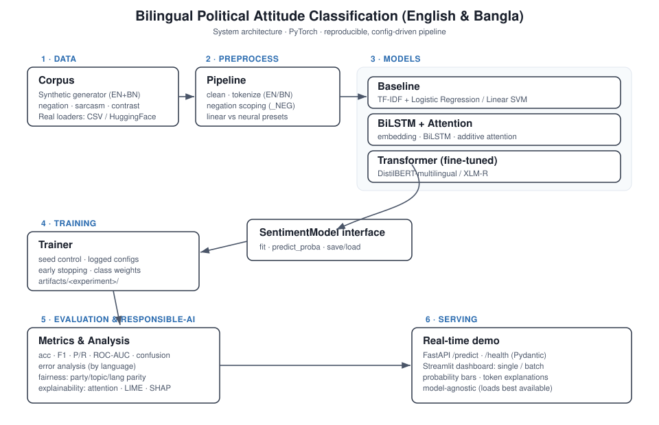
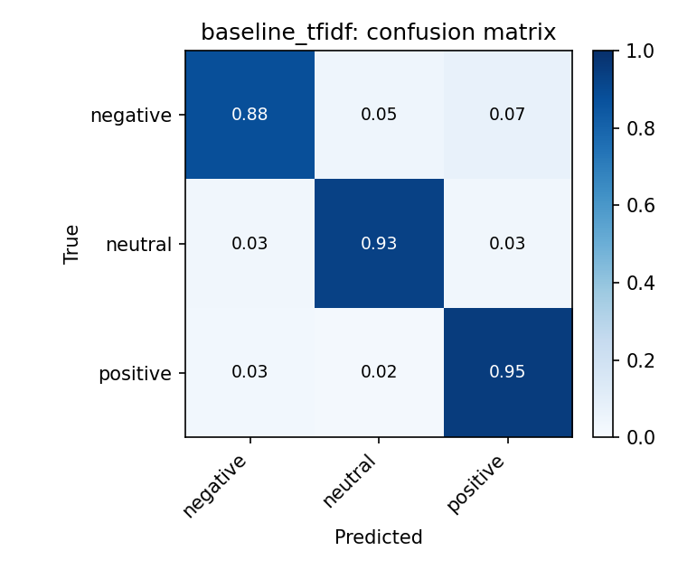
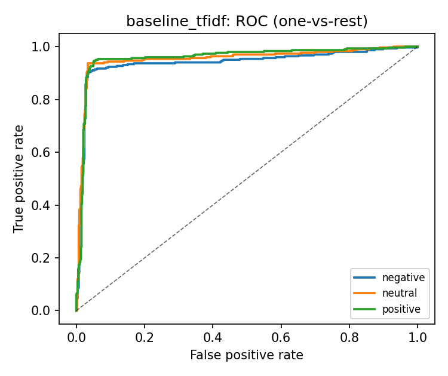

# Bilingual Political Attitude Classification (English & Bangla)

<!-- Replace USER/REPO below with your GitHub path after pushing. -->
[](https://github.com/USER/REPO/actions/workflows/ci.yml)


A modular, reproducible research codebase for bilingual political attitude
classification. It classifies the sentiment
(*negative / neutral / positive*) of **political social-media text in English and
Bangla**, comparing three model families and analysing them for accuracy,
**bias/fairness**, and **explainability**, with a **FastAPI + Streamlit** demo.

Built to thesis / conference-paper standards (European academic framing,
GDPR & EU AI Act discussion). See [`reports/research_report.md`](reports/research_report.md)
for the full write-up.



---

## Task definition

Here, **political attitude** means the sentiment expressed in a political text:
**negative**, **neutral**, or **positive**. The current implementation classifies
whole texts; it does not infer a person's ideology, party affiliation, or
support/opposition toward a separately specified target. Target-specific stance
classification would require target annotations and a revised training task.

The Python import package remains `political_sentiment` for compatibility with
existing commands and serialized models. The distribution and project identifier
are `bilingual-political-attitude-classification`.

## Highlights

| Area | What's included |
|------|-----------------|
| **Models** | TF-IDF + LogReg/SVM baseline · BiLSTM + additive attention · fine-tuned multilingual transformer (DistilBERT / XLM-R) |
| **Languages** | English + **Bangla** (multilingual, script-aware preprocessing) |
| **Data** | Reproducible synthetic generator (negation, sarcasm, contrast, label noise) **plus** documented loaders for real public datasets |
| **Responsible AI** | Bias analysis across parties/topics/languages · attention/LIME/SHAP explainability · GDPR + EU AI Act section |
| **Evaluation** | Accuracy, macro-F1, precision/recall, ROC-AUC, confusion matrix, qualitative error analysis |
| **Serving** | FastAPI inference API + Streamlit dashboard (real-time demo) |
| **Engineering** | Typed, commented, modular · unit tests · seed control · logged configs · `black`/`ruff`/`mypy` |

Framework: **PyTorch** (chosen for clean custom-attention implementation, the
HuggingFace ecosystem, and strong interpretability tooling — see report §IV.A).

---

## Project structure

```
bilingual-political-attitude-classification/
├── configs/                 # YAML configs (base + one per experiment)
├── data/{raw,processed,synthetic}/
├── src/political_sentiment/
│   ├── data/                # schema, synthetic generator, loaders, splitting, IO
│   ├── preprocessing/       # cleaning, tokenization, negation, pipeline
│   ├── models/              # base interface, baseline, bilstm, transformer, registry
│   ├── training/            # trainer + multi-model comparison
│   ├── evaluation/          # metrics, plots, error analysis, evaluate CLI
│   ├── fairness/            # bias analysis across parties/topics/languages
│   ├── explainability/      # LIME / SHAP / attention wrappers
│   ├── api/                 # FastAPI service (schemas + app)
│   ├── dashboard/           # Streamlit demo
│   └── utils/               # config loading, seeding, logging
├── notebooks/               # 01 EDA · 02 baseline · 03 deep learning
├── tests/                   # pytest unit tests
├── reports/research_report.md
└── docs/architecture.svg
```

---

## Setup

Requires Python 3.9+.

```bash
# 1. Create an environment (recommended)
python -m venv .venv && source .venv/bin/activate

# 2. Install dependencies + the package
pip install -r requirements.txt
pip install -e .
# or: make setup
```

> **Note on heavy dependencies.** `torch` and `transformers` power the BiLSTM and
> transformer models. If you only want the baseline you can skip them — the code
> imports them lazily and the baseline runs on `scikit-learn` alone.

---

## Quickstart

```bash
# 1. Build the dataset (synthetic EN+BN, stratified train/val/test)
make data

# 2. Train + evaluate the baseline (fast, CPU-only)
make baseline
make evaluate CONFIG=configs/baseline_tfidf.yaml

# 3. Train the deep models (needs torch / transformers)
make bilstm
make transformer

# 4. Compare everything side by side
make compare        # -> artifacts/comparison/{summary.csv,model_comparison.png}

# 5. Serve it
make api             # FastAPI at http://localhost:8000/docs
make dashboard       # Streamlit demo
```

Query the API:

```bash
curl -X POST localhost:8000/predict -H 'Content-Type: application/json' \
     -d '{"texts": ["PartyA economy plan is a real step forward",
                     "এই নীতি মোটেও ভালো নয়"]}'
```

---

## Using real data instead of synthetic

The repo ships with a synthetic corpus so it runs fully offline. To plug in a
real public dataset, set the source in `configs/base.yaml`:

```yaml
data:
  source: csv            # or: huggingface
  csv_path: data/raw/my_tweets.csv     # columns: text,label[,language,party,topic]
  # source: huggingface
  # hf_name: <owner>/<dataset>
```

Recommended datasets and licensing notes are in report §III (SemEval stance/
sentiment, GermEval/TASS, Bangla SentNoB, EU-Parliament ParlSpeech, …). Labels in
any space are mapped onto the canonical 3-class scheme automatically.

---

## Reproducibility

- Every run seeds Python/NumPy/PyTorch from `cfg.seed` and requests deterministic
  cuDNN kernels.
- The **resolved** config is written next to each run's artifacts
  (`artifacts/<experiment>/resolved_config.yaml`) together with logs and metrics.
- Data splits are deterministic and stratified.

## Testing & quality

```bash
make test     # pytest unit tests
make lint     # ruff + mypy
make format   # black + ruff --fix
```

---

## Results (measured on this environment)

The two baselines were trained and evaluated on the held-out test split; the
deep models reproduce with `make bilstm` / `make transformer` on a
torch-enabled machine. See report §V for the full table and expected deep-model
ranges.

| Model | Accuracy | Macro-F1 | ROC-AUC (OvR) |
|-------|:--------:|:--------:|:-------------:|
| TF-IDF + Logistic Regression | 0.921 | 0.921 | 0.951 |
| TF-IDF + Linear SVM | 0.921 | 0.921 | 0.948 |
| BiLSTM + Attention | *reproduce with `make bilstm`* | | |
| Transformer (DistilBERT-mBERT) | *reproduce with `make transformer`* | | |

The synthetic corpus is deliberately hard (negation, sarcasm, contrast, ~6%
label noise → ceiling ≈ 0.94), so these are realistic, non-saturated numbers.

<p align="center">
  
  
</p>

The **negative** class is the hardest (recall ≈0.88), with errors flowing toward
*positive* — exactly the confusion induced by negation and sarcasm, which
motivates the negation-aware preprocessing and the contextual deep models.

---

## License

MIT (see `pyproject.toml`). Synthetic data is generated locally and carries no
third-party licensing constraints. Real datasets remain under their own licenses.
